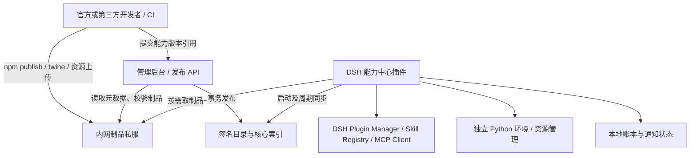
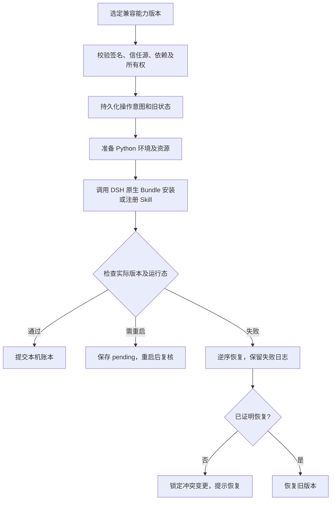

# 能力中心目标架构（私服版）

状态：设计基线，2026-11-27。现行 0.2.12 离线实现见 [DESIGN](../../DESIGN.md)；本文描述待实现的目标，不表示已经通过实机验收。部署及验证见 [内网私服联调](../development/registry-integration.md)，实施顺序见 [迁移计划](../development/migration-plan.md)。

## 1. 产品与边界

面向无法访问公网、可以访问企业内网的 DSH 用户。管理员发布经过验证的能力；用户在 DSH 内发现、安装、更新、卸载、检查及使用能力。能力可以包含 Skill、MCP、Tool、UI、Agent 配置等；npm、wheel、ZIP 是分发格式，Python/Node 库通常只是依赖，不必占据用户目录。能力是独立发布、可管理的用户功能单元，不是某一种压缩包。

中心端负责发布治理与目录，终端负责安装与运行事实。Nexus 等私服负责制品分发，不承载能力审批业务。普通用户不需要另行登录管理端；若企业要求下载认证，使用企业认可的只读认证。默认用户确认安装及升级，不做静默升级、遥测或强制卸载。目录同步不需要模型调用。



## 2. Monorepo 与独立发布

采用 pnpm workspace（根锁文件、统一 lint/typecheck/test、按包构建），不为了单仓库增加 Turborepo、微服务或容器强制依赖。管理端为独立部署的 Web 应用，终端插件作为独立 DSH Bundle，官方能力可以独立更新。第三方能力不必进入本仓库；引入未修改的上游制品可仅维护引用、来源与验收记录。

```text
apps/
  admin/                 # Web UI + HTTP API，一个服务部署
  dsh-plugin/            # DSH bootstrap、core、客户端页面、本地服务
packages/
  protocol/              # schema、类型、兼容性和签名校验
  publisher/             # 发布校验、私服客户端、CLI
  capability-sdk/        # 官方能力模板、manifest 生成和验证
capabilities/
  auto-continue/
  office-enhancement/
  offline-ocr/
  drawio/                # 已维护的官方实现，是否上架单独决定
  ...                    # 每项独立 package.json / 版本 / 说明 / 测试
integrations/            # 上游原样引入记录、固定摘要与验收（如 GenUI）
tests/
  integration/           # 私服、真实 DSH、断公网及端到端
docs/
```

主要目录已迁移至 Monorepo；integrations 独立目录与集成测试分类仍可按后续需要细化。bootstrap 与 core 可在同一终端应用目录内独立构建；协议包只含纯数据及通用校验，不依赖 DSH、数据库或浏览器。SDK 是开发期工具，不是官方能力运行时必须依赖的中心 API。每个可发布包独立 SemVer，目录 revision 单独递增，管理端独立部署版本；发布一项能力不发布终端、管理端或其他能力。workspace:* 只用于开发，发布时必须转换为可解析版本或编译内联；私服验收必须使用真正发布的包而非 workspace 链接。

管理端初步建议 TypeScript + Fastify + React/Vite（单进程提供静态页面和 API），SQLite（本机持久目录、事务及备份）作为单实例起步方案；有企业现成 PostgreSQL 或多实例需求则选 PostgreSQL，先不引入 Redis、队列或微服务。0.3.0 实际实现先采用 Node.js 原生 HTTP、node:sqlite 和原生 Web UI，无额外前端/服务端运行依赖；是否引入 Fastify/React 取决于管理能力规模。管理端不要求部署在 DSH 终端。

## 3. 私服与信任边界

优先复用公司现有 Nexus/Artifactory；无现成设施则以 Nexus Repository 验证 npm hosted、PyPI hosted、Raw hosted 三类。若实际版本授权或资源不适用，可替换为 Verdaccio + PyPI 仓库 + HTTP 文件存储，协议不绑定 Nexus 私有 API。完全断公网时使用 hosted 仓库；第三方依赖闭包从受控引入环境经审批转入，禁止公网回退、Git URL 或安装脚本隐式拉取公网制品。

开发/测试上传凭据仅给开发或发布服务；终端只有正式源读取权限，不能看到未审批的可安装包（测试与正式仓库/权限分离）。管理端接受指定 package/version 或 manifest 引用，验证后发布；普通依赖上传不触发上架。可选 Web 导入与 CLI/CI 都走同一发布验证。生产应使用稳定域名与受信任 HTTPS，签名密钥在发布端，终端内置或受控配置可信公钥；不得把 token、真实内部地址、凭据写进公开源码、目录或日志。

## 4. 能力声明与发布目录

优先原生 DSH npm Bundle；纯 Skill 亦可使用原生 ZIP。不要将 npm node_modules、全部 Python wheel、所有模型重复塞入统一 ZIP。能力元数据由作者维护，可在 package.json 的自定义 capability 字段或独立 capability.json 中提供；第三方原包无字段时允许管理员/引入者提供独立 descriptor，不改变原制品。npm name/version/engines/dsh/dependencies 以原生包元数据为准，发布服务校验展示声明与实际包的一致性，不手工复制版本。

示意（具体 schema 由 protocol 包定义并测试）：

```json
{
  "id": "document-ocr",
  "version": "1.0.0",
  "title": "智能文档识别",
  "description": "在本机识别文档",
  "features": ["skill", "tool"],
  "compatibility": {"dsh": ">=0.2.1-rc.2 <0.3.0", "platforms": ["win32-x64", "darwin-arm64"]},
  "components": [
    {"type": "bundle", "package": "@company/dsh-document-ocr", "version": "1.0.0", "source": "npm-internal"},
    {"type": "python-env", "lock": "requirements.lock", "source": "pypi-internal"},
    {"type": "asset", "source": "raw-internal", "path": "ocr/1.0.0/model.zip", "sha256": "<64 hex digits>"}
  ]
}
```

以上为示例、非已发布包或最终合法 schema；source 是由管理员配置的可信仓库 ID，不允许从未受信目录执行任意 URL、命令或 JS。版本锁、摘要、大小、平台、架构和依赖关系均按组件声明；npm 使用 registry integrity（及发布验证的制品摘要/依赖解析记录），Python 使用目标平台 lock 与 wheel 哈希，资源使用固定路径和 SHA-256。依赖闭包验证应在无公网、空缓存环境中进行；固定根版本不等于固定全部 npm 传递依赖，必须控制正式仓库允许的依赖版本及解析结果，不直接信任作者机器的 node_modules。

目录为独立的签名版本化快照：schemaVersion、revision、发布源标识、publishedAt、能力 ID、版本列表、首次上架时间、更新说明、分类、可用状态、兼容约束、组件、检查声明及安全撤回记录。客户端选择最高兼容的正式版本，不简单选最高版本。支持测试/正式通道；同 ID/version 制品与安装声明不可覆盖；展示文案若需修订另记目录 revision。普通下架保留本机可检查和卸载；安全撤回禁止新增安装并提示已安装用户处理，不默认强制卸载。历史制品保留期要覆盖回滚需求。签名、revision 防回滚与密钥轮换应独立于核心版本；签名失败不得覆盖最后可信目录。参考 [DSH 官方市场索引](https://github.com/deepseek-ai/deepseek-harness/blob/dsh-v0.2.1-rc.2/docs/user/guide/plugin-market.md)，可生成其兼容投影，但不假定原生市场支持 Python、组合或所有目标版本的企业交互。

发布流程：开发者发布实际制品到受控私服 → 管理端接收版本引用并自动读取描述 → 验证格式、身份、依赖闭包、兼容及安全验收证据 → 草稿/测试 → 审核上架 → 原子提交新 revision → 客户端发现。发布状态、审计及不可变版本记录持久化在管理端数据库，不随着 dist 构建覆盖；只有全部制品就绪才发布目录。Web 与 CLI/CI 共用校验/权限。管理端 MVP：身份及发布权限、能力列表、版本引用/导入、自动解析、校验、发布/下架/撤回、历史与审计、只读 catalog/core index 接口。上传实际包是可选辅助能力，不是唯一入口。

## 5. DSH 原生接口与适配层

以官方 dsh-v0.2.1-rc.2 为源码基线，macOS 0.2.2-rc.3 和 Windows 定制版需要逐项验收。

| 对象 | 实现 | 原生事实/边界 |
| --- | --- | --- |
| DSH Bundle | ctx.pluginManager.installBundle(spec, {registry, saveExact:true, enabled:true}) / removeBundle / listBundles / setBundleEnabled | rc.2 确认存在；底层 pnpm 管理 Node 依赖及 profile；实际热加载、更新和恢复需验证 |
| Skill | 优先 Bundle 中 ctx.skills.registerProvider；纯 Skill ZIP 安全解包到受管 root，经原生文件发现或 Provider 注册 | ctx.skills 发现、注册及生命周期有据；未确认通用远程 Skill 安装器 |
| MCP | 优先 Bundle 配置官方 dsh-mcp-client，远程 Streamable HTTP、本地 stdio | rc.2 确认 client；不假定存在独立 MCP Manager 安装 API；检查真实工具注册 |
| Node | Bundle dependencies；本地 Node MCP 用已安装入口和受控 Node 路径 | pnpm 解析，不手工写 node_modules，不用运行期 npx latest |
| Python | load_workspace_dependencies 获取真实解释器；新增依赖以版本化独立 venv + pip --require-hashes 为主 | 未发现通用 Python 安装 API；不改 DSH 自带 site-packages；pip/venv 和 Win7 wheel 需验证 |
| 其他资源 | Raw 下载、哈希、版本化缓存、解包、所有权清理 | 中心管理；禁止任意远端 shell 安装声明 |

源码：[Plugin Manager](https://github.com/deepseek-ai/deepseek-harness/blob/dsh-v0.2.1-rc.2/packages/boot/plugin-manager/src/index.ts)、[Options](https://github.com/deepseek-ai/deepseek-harness/blob/dsh-v0.2.1-rc.2/packages/boot/plugin-manager/src/types.ts)、[Skill Filesystem](https://github.com/deepseek-ai/deepseek-harness/blob/dsh-v0.2.1-rc.2/packages/skill/skill-filesystem/README.md)、[Skill Provider 示例](https://github.com/deepseek-ai/deepseek-harness/blob/dsh-v0.2.1-rc.2/packages/experimental/skill-badge/src/index.ts)、[MCP Client](https://github.com/deepseek-ai/deepseek-harness/blob/dsh-v0.2.1-rc.2/packages/mcp/mcp-client/README.md)、[Workspace Dependencies](https://github.com/deepseek-ai/deepseek-harness/blob/dsh-v0.2.1-rc.2/packages/skill/tool-workspace-dependencies/README.md)。

远程业务 MCP 优先集中部署、服务端鉴权；本地文件型 MCP 使用本地进程，卸载终止所属连接/进程。Python 及资产路径通过显式受控配置或 SDK 运行时查询提供给 Bundle/Skill，不要求修改宿主全局 PATH。单纯复用 DSH 内置 Python 的能力不创建额外环境。独立环境按能力、版本和解释器身份区分，更新准备新环境后切换；不直接删除其他能力或手动安装的文件。MCP 凭据由宿主受控配置注入，不进入目录或包。

## 6. 安装事务



Bundle 是否能直接替换版本、pnpm profile 锁与回滚能力必须由测试决定；未证实前不承诺无损热更新。不能直接卸载别的渠道手动安装的插件，先识别外部/借用所有权；允许用户显式接管才写入受管关系。更新成功需宿主返回及实际运行态共同确认；待重启不是成功激活。保留现有 journal/ledger、健康检查、失败回滚、可信草稿桥，不把 pnpm/pip 已有职责重新实现。卸载按所属关系及逆序清理，目录不可达也能本地卸载；必要的旧包、环境及依赖闭包保留用于恢复。已发布版本的健康检查声明只能是允许的类型，不能任意执行服务器指定脚本。

## 7. 同步与通知

本地插件服务统一调度，同一 DSH profile 合并并发请求；启动、页面打开（缓存过期）、每 15 分钟加随机抖动、网络/休眠恢复、手动检查。DSH 完全退出停止，不注册 OS 服务、不固定凌晨、不使用中心推送。UI 订阅本地状态（先用本地查询与事件），刷新页面不重复拉取私服。配置和缓存持久化在本机受管目录，离线开关不请求远端；同步采用 ETag / If-None-Match，304 不重新处理，失败保留可信快照并退避，显示最后成功时间和过期状态。

红点 = 未读上新 + 待处理兼容更新 + core pending/更新 + 重要安全公告。首次成功同步建立基线，不将全部历史能力标为新；隐藏依赖、未安装能力普通版本变化、网络失败不新增红点。打开上新列表/标记已读消除对应未读；更新完成且验证成功、忽略该版本或暂缓才消除对应更新提示；新版本重新提示。能力页顶部 Notification 汇总，并链接筛选结果；不重复弹窗。安全撤回保持提示直到处置。目录中的已安装项下架仍显示本地事实。通知、忽略、已读按 profile 与发布源隔离。

## 8. 自身更新与验证边界

继续保留 Bootstrap + Core Supervisor、独立核心索引、健康检查及失败回退；bootstrap 低频升级，优先 DSH 原生安装机制，是否能安全原位自更新必须验证，未验证前保留人工替换。核心与目录协议独立，旧核心不能读新 schema 时仍可检查核心更新。只在实机验证有更简单可靠的替代路径后才考虑移除 supervisor。

macOS 私服和 DSH 先行打通功能及协议，随后 Win10 rc.2、Win7 rc.5-win7 验收。Windows 7 的解释器、wheel ABI、TLS/证书、进程启动、宿主 hot reload 都可能成为实质约束，不能提前保证只需小修。兼容表必须由真实试验填写；发布只允许已验证的目标矩阵。