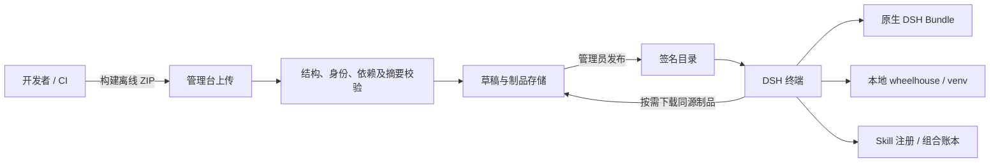

# 离线能力包架构与协议

## 边界

管理后台是唯一上传和发布入口。开发者构建自包含 ZIP，管理员上传，后台只解析、检查及持久化，不运行上传代码。终端同步目录、下载所需制品，使用 DSH 原生插件管理、Skill 注册或独立 Python 环境安装。组合能力仅引用已经发布的能力，不重复内嵌子能力。



Monorepo 不变：apps/admin、apps/dsh-plugin、packages/protocol、packages/publisher、packages/capability-sdk、capabilities、integrations。运行端与管理台之间只需 HTTP(S)，无 npm、PyPI、Raw 服务。后台采用 Node HTTP、SQLite 与本地内容寻址文件，不引入额外中间件。

## 上传协议 v1

ZIP 根目录必须有 capability.json，结构为 {"schemaVersion":1,"item":{...}}。其他文件位于 payload/，全部必须在 item 中声明，无任意未声明文件。目录仍使用 schemaVersion 2，发布服务校验并将 payload 路径转换为自己的同源内容摘要路径；原 ZIP 保留供审计，终端下载校验过的内部原生制品，不必重复下载组合中的其他能力。

| 类型 | 内容 |
| --- | --- |
| plugin | 原生 .tgz（含第三方 npm 运行依赖及静态资源），可附运行资源及 wheelhouse |
| skill | 内部技能 ZIP：能力 ID/SKILL.md 及脚本等，可附运行资源及 wheelhouse |
| composite | 只有能力声明，固定 ID/version 子能力引用；无内嵌制品 |
| core | 内部核心 ZIP，走相同上传、草稿、发布流程，但在独立核心索引中出现 |

示例组合声明（A/B 必须已上传并发布，版本为示例）：

```json
{
  "schemaVersion": 1,
  "item": {
    "id": "office-toolkit",
    "type": "composite",
    "name": "办公工具集",
    "version": "1.0.0",
    "description": "组合办公增强与离线识别",
    "dependencies": [
      {"id": "office-enhancement", "version": "1.1.0"},
      {"id": "capability-center-ocr", "version": "0.2.0-offline.1"}
    ],
    "checks": [{"type": "dependencies-ready"}],
    "usage": {"steps": ["安装组合", "使用子能力"], "inputs": "本地文档", "output": "处理结果", "example": "识别文档并处理 PDF"},
    "trial": {"prompt": "介绍已安装的办公能力及用法"}
  }
}
```

独立能力还需要 artifact：path、bytes、sha256。plugin 增加 install.packageName 及 plugin-bundle 检查；skill 增加 skill-discovery 检查。所有能力都有固定 ID、SemVer、说明、使用方式和试用提示。兼容条件可声明 dsh、os、arch、python。构建工具根据真实字节填充摘要与大小。

### npm
运行依赖使用真实 npm bundleDependencies，把完整传递闭包随 TGZ 打包，不允许 Git/URL/file 依赖或依赖安装脚本。可选平台依赖、宿主提供的 @deepseek-ai peer 仍需目标机验证；不要将宿主自身依赖重复打包。终端使用本地 TGZ，并显式指定不可用的 loopback registry；rc.2 源码表明未知 registry 不进入配置的默认 fallback 列表，但实际 DSH/pnpm 行为、作用域配置、锁文件及断公网需真实验收。构建阶段允许在受控开发环境准备依赖，终端不能联网补齐。

### Python
runtime.python.requirements 是固定 name/version/hashes 数组，runtime.assets 必须包含名为 wheelhouse、format 为 zip 的资源；ZIP 根目录存放所有锁定 wheel。禁止 sdist、网络依赖及任意安装命令；终端用 DSH Python 创建独立 venv，pip --no-index --find-links --require-hashes --no-deps 安装，随后执行 pip check。所有额外依赖闭包都要放入 wheelhouse；明确声明 inheritBuiltin 时可继承宿主内置库（Office 使用）。目标平台需有匹配 OS/架构/ABI wheel；不兼容时失败而不是在线补齐。资源也可以通过其他已声明 ZIP 或 BIN 随包交付。

### 组合
发布前校验引用版本均已上架。发布新的子版本不破坏旧组合，已发布旧版本可继续被引用；无法下架仍被已发布组合引用的版本。终端复用已安装的相同版本，所有权引用用于安全卸载。不同版本冲突不静默降级；目前只支持平面组合，不支持嵌套组合。

## 管理与信任边界

上传最大 128 MiB，单个 payload 最大 32 MiB，按解压大小和文件数量限制，拒绝路径穿越、链接、重复文件、缺少哈希与不合法 Bundle。发布端使用 SQLite 事务、内容寻址的制品和原上传包收据，同 ID/version 的规范化声明和摘要不可覆盖。管理员令牌与终端访问分离；核心索引独立；目录可 Ed25519 签名；终端验证 SHA256、大小、可信同源与 revision。下架不删除已安装能力，撤回阻止分发相应版本（相同摘要若仍被其他有效版本引用仍可能提供）。生产部署应通过内网 HTTPS、可信签名及外部网络阻断保证依赖不回源，当前单管理员模式不是企业 RBAC。

## 验收

管理台及解析器可通过本地 CI 测试；实际宿主安装/激活、跨平台 wheel/native addon、MCP 生命周期、断公网、Win7/Win10、权限和备份恢复需目标机验收。
